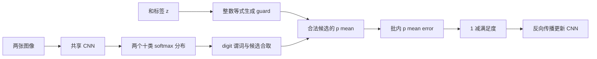

# MNIST 加法任务实现分析

调研日期：2026-11-05。依据《课题简介.docx》；下面为任务分解、源码事实和理论推导，没有本项目训练结果。

## 1 输入、监督、输出分开定义

训练样本为 \((x_i,y_i,z_i)\)，\(x_i,y_i\) 是两张图，\(z_i\in\{0,\ldots,18\}\)。共享 CNN 输出两个 10 类分布 \(u_i,v_i\)，不直接输出 19 类和。数字真值 \(a_i,b_i\) 只用于构造和与独立评价，不传给训练损失。这满足简介“仅提供两图之和标签”的要求。

【源码】LTNtorch 用官方 MNIST 训练/测试来源分别配对，得到 30,000/5,000 对。[R5 数据 cell 1](https://github.com/logictensornetworks/LTNtorch/blob/d1bd98169cc2121f8cdd25ff99901e4589923c95/examples/4-semi-supervised_pattern_recognition.ipynb)。项目若增加验证集，应先划分图像再各自配对，避免同一图像跨训练与验证；这会改变训练规模，必须作为协议选择记录。

## 2 公式与有效候选

\[
\forall\operatorname{Diag}(x,y,z)\quad
\exists a,b:(a+b=z)\quad D_\theta(x,a)\land D_\theta(y,b).
\]

它要求每对图像存在合法的数字解释。guard 不是需要学习的神经网络，也不是软等号。[R2 式(39)](https://arxiv.org/pdf/2012.13635#page=29)、[R5 cell 9](https://github.com/logictensornetworks/LTNtorch/blob/d1bd98169cc2121f8cdd25ff99901e4589923c95/examples/4-semi-supervised_pattern_recognition.ipynb)。

以 z=3 为例，候选为 (0,3)、(1,2)、(2,1)、(3,0)，m=4。Product 的候选真值为 \(u_0v_3,u_1v_2,u_2v_1,u_3v_0\)；存在聚合使用这些值的 p-mean。错误实现“对全部 100 个候选乘 mask 后直接 mean”会把分母错设为 100，额外引入标签相关尺度变化。

## 3 计算与梯度图

【分析】guard 会筛掉不合法解释；梯度穿过合法位置的真值、softmax 和 CNN。softmax 类别相互耦合，因此仍需分析完整计算图，不能将 guard 误解为独立地冻结不合法 logits。

【源码】LTN 广播大致形成 `[B,10,10]` 候选真值，存在量化消去两个数字轴得到 `[B]`，全称量化后是标量。`ltn.diag` 负责合并样本对应轴；维度的实际顺序由 `.free_vars` 决定，不应仅凭 reshape 假定轴序。[R5 core.py](https://github.com/logictensornetworks/LTNtorch/blob/d1bd98169cc2121f8cdd25ff99901e4589923c95/ltn/core.py#L1428)。

## 4 和的两种预测口径

**与 LTNtorch 示例一致的硬预测**：

\[
\widehat d(x)=\arg\max_d u_d(x),\qquad
\widehat z_{hard}=\widehat d(x)+\widehat d(y).
\]

**概率边缘化后的和预测**：在两个潜在数字按各自分布独立抽样的语义下，

\[
P_\theta(z\mid x,y)=\sum_{a+b=z}u_a(x)v_b(y),\qquad
\widehat z_{prob}=\arg\max_{z\in\{0,\ldots,18\}}P_\theta(z\mid x,y).
\]

【推导】两者可能不同；比较方法时应统一主指标口径，并可同时报告二者。概率式可作为共同解码器用于任何方法输出的数字分布，而不是只给概率模型使用。[R5 硬预测源码](https://github.com/logictensornetworks/LTNtorch/blob/d1bd98169cc2121f8cdd25ff99901e4589923c95/examples/4-semi-supervised_pattern_recognition.ipynb)、[R6 概率逻辑出处](https://proceedings.neurips.cc/paper_files/paper/2018/file/dc5d637ed5e62c36ecb73b654b05ba2a-Paper.pdf#page=3)。

## 5 p=1 的 Product 与精确概率和有何关系

【推导，忽略 stable 投影】

\[
s_i^{LTN,p=1}=\frac{1}{m_{z_i}}\sum_{a+b=z_i}u_{ia}v_{ib}
=\frac{P_\theta(z_i\mid x_i,y_i)}{m_{z_i}}.
\]

二者相差标签相关的合法候选数，而不是完全无关的计算。若两个数字都被确定性地正确识别，存在满足度也只有 \(m_z^{-1/p}\)，有限 p 下不一定等于 1。特别是 z=9 有十个合法候选，不能期待和为9的理想样本在 p=1 时 Sat=1。

在 Product 且两个分布归一化的假设下，\(\sum_{a+b=z}u_av_b\le1\)，且 \(\sum t_j^p\le\sum t_j\)，故 \(M_p(t)\le m_z^{-1/p}\)。stable 投影会微调此界，以上只是理想式推导。

【分析】LTN 的 `1-Sat`、全称 q=2 的误差聚合，与精确概率模型常用的 \(-\log P(z)\) 梯度权重也不同。即使比较同一个 CNN，也不能把差别全部归因于“规则硬或软”。如果需隔离效应，应把损失形式与聚合归一化另作消融，需导师批准。

## 6 现代 DeepLog 示例为何不能直接当公平对照

【源码】KU Leuven 的 [DeepLog 固定提交示例](https://github.com/ML-KULeuven/deeplog/blob/af035231a881ff1d803c3d39ea194043cd096cf3/examples/deepproblog.md#L181) 使用自己的 MNISTNet、相邻图像配对、Normalize((0.5,),(0.5,))、训练子集与小测试子集；训练示例采用 NLL，并另外演示 sampling。其 CNN 通道为 8/16，也不等于 LTNtorch 的 6/16。

【分析】直接运行两个官方示例后比准确率，将同时改变网络、数据、预处理、损失和评估方式。应先确认对照框架，再统一这些因素；是否调用框架本体或仅实现枚举概率聚合层也要明确。手写枚举层可验证某个计算目标，但不能冒充完整 DeepProbLog/DeepLog 复现。

## 7 退化解需有条件地解释

**常数预测**：所有图片 argmax 为 0，只能把真实和为 0 的样本判对。若真实两数字独立均匀，其和准确率是 1/100；这只是理论参照，真实 MNIST 应按测试和分布计算。因此全预测0不是正常广覆盖加法监督下的高质量全局解，可能是优化停滞或数据失衡。

**数字偏移**：若两边共用同一分类器，且把所有 d 预测成 d+c，那么无越界时预测和偏移 2c，不能抵消。左右独立网络才可能各偏移 +c 与 -c；本课题默认共享 CNN，不应照搬这种解释。模 10 偏移还会引入截断或进位问题，需从混淆矩阵实际检验。

**更一般的不可辨识性**：设训练只覆盖部分数字对，潜在映射 f 只需满足这些边上的 \(f(a)+f(b)=a+b\)，可能存在多解。如果所有数字自配对均有约束，则 \(2f(a)=2a\) 已迫使 f(a)=a。有限图像、有限配对和神经网络泛化仍使实际学习复杂；上述为数字级理想模型，不是成功保证。

**误差抵消**：个别样本上数字误差满足 \(e_x=-e_y\) 可使和正确但数字都错。建议统计“和正确且至少一个数字错误”的比例，结合混淆矩阵、配对覆盖与数字识别准确率判断，而不只看和准确率。

**Łukasiewicz 死区**：若所有合法候选的两个概率之和都小于1，则该批无合取梯度。它属于训练机制风险，应与训练完成后的常数预测分开报告；增大 p 未必能解救。[R5 AndLuk](https://github.com/logictensornetworks/LTNtorch/blob/d1bd98169cc2121f8cdd25ff99901e4589923c95/ltn/fuzzy_ops.py#L461)。

## 8 后续实现前应验证的接口与数据契约

以下为将来验收项，本阶段未执行：输入范围/形状、和标签范围、训练不读取单数字标签、共享权重、diag 与 guard 轴正确、guard 非空、有限 loss 与梯度、梯度确实到 CNN、train/eval 切换、按样本数计算指标、训练验证测试图像无交叉。先做少量张量与单批检查，再开始正式训练；不应通过先引入单数字预训练来掩盖死区。
